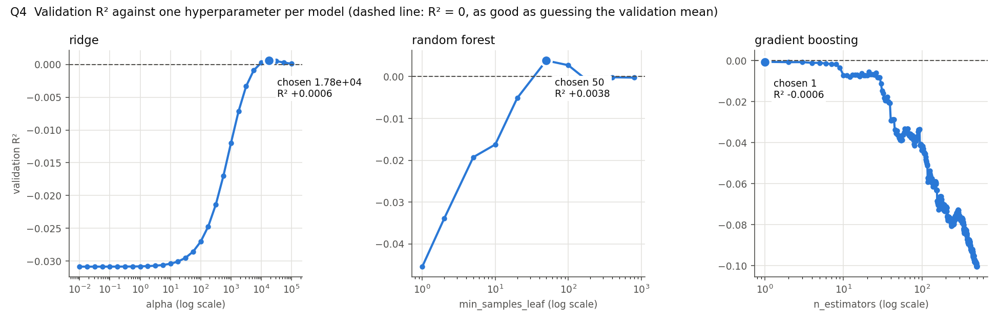
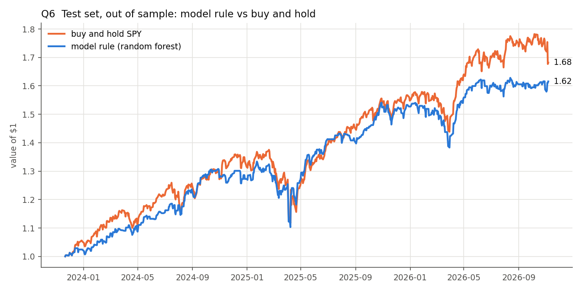
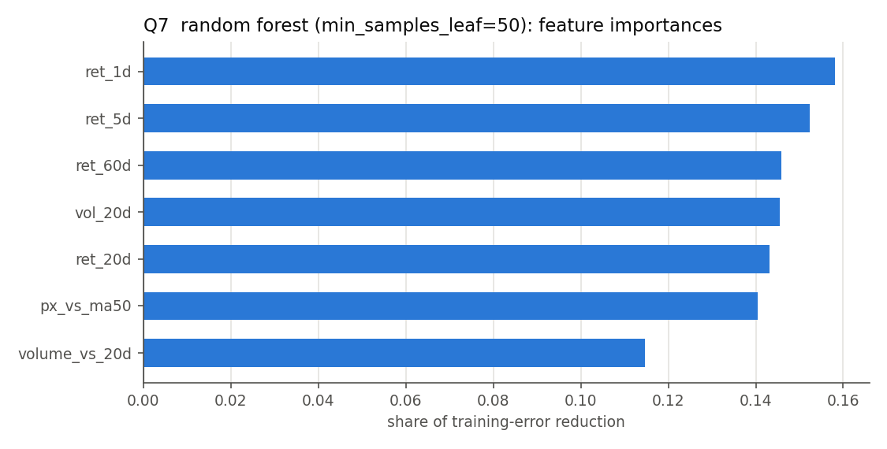

# Homework 7: Machine learning on next-day SPY returns

All numbers come from `hw07_starter.py`, run on Sunday 2026-11-08, so the last close is **Friday 2026-11-06**. The printed output is in `hw07_output.txt` and the plots are the `q*.png` files. The prices and T-bill rates used are saved in `data/`, so `python hw07_starter.py --snapshot` reproduces every number. `robustness.py` (output in `robustness_output.txt`) refits the final model under different random seeds and under tiny price perturbations.

## The short version

- Fifteen years of SPY, seven features built only from past data, split by time 60/20/20.
- At default settings the random forest has a training R² of **0.85** and a validation R² of **−0.045**. All four models are negative on validation.
- Tuning helped every model in the same way: by making it predict less. The best validation R² was **+0.0038**, from a random forest with `min_samples_leaf=50`. On the test set it scored R² **+0.0067**, correlation **+0.088**.
- The trading rule made money (**+17.7% a year**) but lost to buy-and-hold (**+19.3%**), because the days it sat out still went up on average.
- None of the edge can be told apart from luck. The correlation comes mostly from a few days in April 2025. Changing only the forest's random seed moves the rule's return anywhere from +13.6% to +18.8% a year, and in 40 refits it never beats buy-and-hold.

## Q1. The dataset

The data is `yf.download("SPY", auto_adjust=True)` from 2011-11-08 to 2026-11-06: **3,771 trading days**. Closes are adjusted for dividends, so the returns are total returns.

| Feature | Definition | Data it reads for day *t* |
|---|---|---|
| `ret_1d`, `ret_5d`, `ret_20d`, `ret_60d` | close(*t*) / close(*t−k*) − 1 | the closes on days *t−k* and *t* |
| `vol_20d` | standard deviation of the last 20 daily returns × √252 | closes *t−20* to *t* |
| `px_vs_ma50` | close(*t*) / mean of the last 50 closes − 1 | closes *t−49* to *t* |
| `volume_vs_20d` | volume(*t*) / mean volume of the previous 20 days | volumes *t−20* to *t* |
| **`next_ret`** (the label) | close(*t+1*) / close(*t*) − 1 | close *t+1*, the only future value |

The table has shape **(3710, 8)** and runs from 2012-02-06 to 2026-11-05. It loses 61 of the 3,771 days: the first 60 are warm-up for the 60-day return, and the last day has no next day to supply a label.

```
              ret_1d   ret_5d  ret_20d  ret_60d  vol_20d  px_vs_ma50  volume_vs_20d  next_ret
2012-02-06  -0.00067 +0.02345 +0.05278 +0.05804 +0.08551    +0.06110       +0.76137  +0.00253
2012-02-07  +0.00253 +0.02642 +0.05288 +0.10137 +0.08551    +0.06061       +0.97201  +0.00297
2012-02-08  +0.00297 +0.02053 +0.04693 +0.09433 +0.08248    +0.06049       +0.98677  +0.00126
```

The label on 2012-02-06 (+0.00253) reappears as `ret_1d` on 2012-02-07. Each day's label becomes the next row's past return, and nothing flows the other way.

**How look-ahead is ruled out.** `build_features` loops over the days. For day *i* it passes `prices[:i+1]` to the feature function, which is the history up to that close and nothing more, so a feature cannot read the future even by mistake. The label is computed separately. Every feature is a ratio of prices, so when Yahoo rescales old closes for a later dividend, the rescaling cancels out.

**Hand check of the row for 2020-03-16**, the COVID-crash Monday (−10.9%). Each value was recomputed with pandas, directly from the raw prices by date:

| Column | Table | By hand | Built from |
|---|---:|---:|---|
| ret_1d | −0.10942 | −0.10942 | close 2020-03-13 (244.88) → 2020-03-16 (218.09) |
| ret_5d | −0.12537 | −0.12537 | close 2020-03-09 → 2020-03-16 |
| ret_20d | −0.28954 | −0.28954 | close 2020-02-14 → 2020-03-16 |
| ret_60d | −0.24577 | −0.24577 | close 2019-12-17 → 2020-03-16 |
| vol_20d | 0.76952 | 0.76952 | 20 daily returns, 2020-02-18 to 2020-03-16 |
| px_vs_ma50 | −0.24471 | −0.24471 | 50 closes, 2020-01-03 to 2020-03-16 |
| volume_vs_20d | 1.38376 | 1.38376 | volume on 03-16 / mean volume 2020-02-14 to 03-13 |
| next_ret | +0.05399 | +0.05399 | close 2020-03-16 → 2020-03-17 (the label) |

No feature reads a date later than the row's own. As a second check, I multiplied every close after 2020-03-16 by 2.5 and every volume by 3, then rebuilt the table. All 2,040 feature rows up to that date stayed the same, and that day's label changed, as it should.

`check_hw07.py` passes 5/5, but its look-ahead test has a blind spot. It changes prices from row 400 onward and compares only rows 0–299, so a feature that peeks a single day ahead (`p[i+1]`) still passes. I confirmed this with a deliberately leaky version. The rewrite check above changes every price after the checked row, and it does catch that leak.

## Q2. Split by time

| Set | Rows | Dates | Up days | Mean / day | Sd / day |
|---|---:|---|---:|---:|---:|
| Training | 2,226 | 2012-02-06 to 2020-12-08 | 55.7% | +0.058% | 1.04% |
| Validation | 742 | 2020-12-09 to 2023-11-20 | 51.9% | +0.041% | 1.12% |
| Test | 742 | 2023-11-21 to 2026-11-05 | 56.5% | +0.075% | 0.97% |

The date ranges do not overlap, and each of the 3,710 rows falls in exactly one set. The three periods are different markets:

- Training includes the 2020 crash.
- Validation includes the 2022 bear market.
- Test is a strong bull market, interrupted by the April 2025 tariff crash.

## Q3. Four models at default settings

| Model | Train R² | Validation R² |
|---|---:|---:|
| Linear regression | +0.0303 | −0.0308 |
| Ridge (α = 1) | +0.0303 | −0.0308 |
| Random forest (300 trees) | **+0.8450** | −0.0454 |
| Gradient boosting | **+0.4589** | −0.0425 |

The default random forest explains 85% of the variance in returns it was trained on, and does worse than guessing on returns it has not seen. Each of its leaves holds a single day, so it has memorised 2,226 noisy numbers.

Ridge with α = 1 matches OLS because that penalty is negligible against 2,226 rows. Both linear models standardise their inputs inside a pipeline, so the scaler learns its means and standard deviations from the training rows only.

## Q4. Tuning on validation

| Model | Hyperparameter | Grid | Chosen | Val R² | Train R² |
|---|---|---|---:|---:|---:|
| Ridge | alpha | 0.01 to 100,000 | 17,800 | +0.0006 | +0.0072 |
| Random forest | min_samples_leaf | 1 to 800 | 50 | **+0.0038** | +0.0619 |
| Gradient boosting | n_estimators | 1 to 500 | 1 | −0.0006 | +0.0283 |



All three curves tell the same story. Validation R² climbs toward zero as each model is forced to predict less: more shrinkage, bigger leaves, fewer trees. The ridge penalty that won cuts training R² from 0.030 to 0.007. The best gradient-boosting model is a single tree, which is close to predicting a constant. In effect, the validation set says the best forecast is roughly "predict the average".

## Q5. The best model, run once on the test set

The selection rule was written into the code before any model was fitted: pick the highest validation R². The winner was the **random forest with `min_samples_leaf=50`** (+0.0038).

| Test-set measure | Value |
|---|---:|
| R² (sklearn, against the test set's own mean) | **+0.0067** |
| R² against the training-mean forecast | +0.0070 |
| Correlation, predicted vs actual | **+0.0879** (one standard error ≈ 0.037) |
| Rank correlation (Spearman) | +0.0468 |
| Correlation without the 5 largest moves | +0.0543 |
| Sign right | 53.1%, vs 56.5% for "always up" |
| Spread of predictions | sd 0.11% a day, vs 0.97% for actual returns |

These numbers look better than they are.

- The correlation of 0.088 is 2.4 standard errors, but a few days in April 2025 carry most of it. On 2025-04-08 the model predicted +0.48%, and the next day SPY rose 10.5% on the tariff pause.
- Rank correlation can't be dominated by a few huge days, and it is only 0.047 (p ≈ 0.2).
- The model also gets the sign right less often than simply calling "up" every day.

## Q6. The trading rule

**The rule:** hold SPY tomorrow if the model predicts a positive return; otherwise hold cash at 0%.

**The backtester:** HW4's `backtest()`, imported unchanged and run with `lookback=1`. Each day it hands that day's close to a small adapter, which returns the model's decision for the same day. The adapter checks that the close matches, so a one-day misalignment would raise an error instead of passing silently.

**The period:** 2023-11-21 to 2026-11-06, 742 trading days.

| | Annual return | Max drawdown | Invested | Annual vol | Sharpe (cash = 0) | Total |
|---|---:|---:|---:|---:|---:|---:|
| Model rule | **+17.69%** | −17.3% | 68.9% | 13.6% | 1.27 | +61.6% |
| Buy and hold | **+19.32%** | −18.8% | 100% | 15.5% | 1.22 | +68.2% |



| Diagnostic | Result |
|---|---|
| Mean next-day return: days held vs days sat out | +0.099% (511 days) vs +0.021% (231 days) |
| Random timing at the same 68.9% exposure (20,000 shuffles) | median +12.94% a year; the rule beats 84.1% of them |
| Cash earning the T-bill rate (4.30% average) instead of 0% | rule +19.29% vs buy and hold +19.32% |
| Costs: 256 position changes at 1 bp each | the rule drops to +16.67% |
| Same rule on validation (where it was picked, so flattering) | +11.19% vs buy and hold +9.09%; days sat out averaged −0.024% |

From `robustness.py`, with `min_samples_leaf=50` held fixed:

| Refit | Test R² | Correlation | Rule, annual | Beat buy and hold |
|---|---|---|---|---|
| 20 random seeds for the forest | +0.002 to +0.007 | +0.068 to +0.089 | +13.6% to +18.8% (median +16.5%) | 0 of 20 |
| 20 draws of one-in-a-million noise on every close | +0.0065 to +0.0071 | +0.087 to +0.090 | +15.4% to +18.0% | 0 of 20 |

The one-in-a-million noise is about the size of the difference between two downloads of the same Yahoo data. My first test run used an earlier download and gave +16.49% (R² +0.0066, correlation +0.0875). The final run, on the data saved in `data/`, gave +17.69%. The model choice and the code were identical.

## Q7. What the models leaned on

| Feature | OLS coef (bp per 1 sd) | Ridge coef | RF importance | GB importance | Test R² drop when permuted (RF) |
|---|---:|---:|---:|---:|---:|
| ret_1d | −17.82 | −1.77 | **0.158** | **0.580** | −0.0018 |
| ret_5d | +0.87 | −0.41 | 0.152 | 0.194 | +0.0031 |
| ret_60d | −5.54 | −0.68 | 0.146 | 0.226 | +0.0038 |
| vol_20d | +2.81 | +0.42 | 0.146 | 0.000 | +0.0022 |
| ret_20d | −1.51 | −0.38 | 0.143 | 0.000 | +0.0038 |
| px_vs_ma50 | +2.78 | −0.55 | 0.140 | 0.000 | +0.0052 |
| volume_vs_20d | −4.61 | −0.10 | 0.115 | 0.000 | −0.0001 |

The rows are ranked by the chosen model's importance. Coefficients come from standardised features, in basis points of predicted next-day return per one standard deviation of the feature.



- **The forest's importances are almost flat (0.11 to 0.16).** That is what impurity importance looks like when a model fits noise: every continuous feature offers splits that shave a little off training error.
- **The linear model leans hardest on `ret_1d`** (−17.8 bp): after a one-standard-deviation up day, it predicts a return 0.18% lower the next day. That is short-term reversal, learned largely from March 2020, when SPY swung up and down by 5–10% a day.
- **What a model leans on in-sample is not what helps out of sample.** Shuffling `ret_1d` on the test set *raises* test R² slightly, although it is the forest's top feature and the linear model's largest coefficient.
- **In behaviour, the rule is a reversal bet that sits out calm markets.** It held 77% of the days after a down day, against 62% after an up day. It held only 49% of the calmest third of days, against 79% of the rest. The steady 2024–26 bull market is exactly where sitting out was expensive.

## Q8. Written answer

**Why near-zero validation R² is the expected result, not a bug.** SPY is the most heavily traded security in the world, and these seven features are the first things anyone tries. Thousands of funds and trading firms have run this exact regression on this exact data for decades, with better data, lower costs and faster execution. Suppose yesterday's return or the gap to the 50-day average reliably predicted tomorrow. They would buy today, and their buying would push today's price up until tomorrow's expected return was gone. Exploiting a predictable return is what removes it. What survives is either too small to trade after costs, or payment for bearing risk (the equity premium), which barely changes from one day to the next.

The arithmetic agrees. In training, SPY's daily return averaged +0.058%, with a standard deviation of 1.04%. A model that knew the true expected return every day, even one swinging by as much as its whole average, would explain only (0.058 / 1.04)², about 0.3% of the variance. That is the ceiling, before any estimation error. Over 742 validation days, a model with no skill at all can reach about 0.005 by chance. So a correct pipeline should report an R² near zero. An R² far above zero, like the trees' 0.85 in training, means memorised noise or a leak.

The tuning curves show this directly: every model improved as it was made to predict less, and each topped out near zero, which is the "predict the average" answer. Patterns that do appear also move. The reversal learned in March 2020 did not recur in 2021–23, so the linear model went negative.

**Can the rule still make money? Yes.** R² and a trading rule measure different things. R² scores the *size* of each forecast against the size of each return, in squared error, and a few huge days dominate it. The rule only uses the forecast's *sign*. Multiply every prediction by 100 and R² becomes enormously negative, while the trades stay exactly the same. Here the predictions vary by 0.11% a day against returns that vary by 0.97%, so R² stays tiny even if the ordering of days carries information.

The rule needs something much simpler than variance explained. It makes money if the days it holds rise on average, which almost any rule manages in a rising market. It beats buy-and-hold only if the days it sits out earn less than cash. Small edges also add up when they are repeated. Grinold's fundamental law says a forecast–return correlation of 0.05 (R² of 0.25%), applied to 252 roughly independent daily bets a year, gives an information ratio near 0.8 for a trader who sizes long and short positions by the forecast. Volatility helps too: it is far more predictable than returns, so a rule can sit out turbulent periods and earn a similar return with less risk, even with no skill at forecasting returns.

This test shows both halves. The rule made +17.7% a year, and the days it held (+0.099%) beat the days it skipped (+0.021%), better than 84% of random rules with the same exposure. But the skipped days still rose, so sitting in 0% cash cost 1.6 points a year against buy-and-hold. With cash earning T-bill interest, it roughly tied, with lower volatility. On validation, where the skipped days fell, it won.

None of this is distinguishable from luck. A few April 2025 days carry the correlation, the shuffle test falls short of 95%, and the forest's random seed alone moves the return from +13.6% to +18.8%. A near-zero R² does not rule out profit, but proving an edge takes far more than one three-year window.

## Notes on method

- **Execution.** The features use day *t*'s close, and the label is the close-to-close return from *t* to *t+1*. So the rule has to trade at day *t*'s close, in practice with a market-on-close order sent minutes earlier. Trading at the next morning's open instead would miss the overnight move. This is the same convention as HW4.
- **The split boundary.** The last training label (2020-12-08 → 12-09) uses the first validation day's close. With a one-day label that is a single day of overlap. With a 20-day label, the last 20 training rows should be dropped ("purged").
- **Cash earns 0%** in the HW4 backtester. With rates at 4–5%, that understates any rule that sits out; the T-bill line in Q6 corrects for it.
- **Model selection was partly luck too.** Across 20 forest seeds, the forest's validation R² ranges from −0.0015 to +0.0051. So which model family won Q5 depended partly on the seed.
- **The test set was used for evaluation only.** It was run once the selection rule and grids were fixed, and nothing about the model was changed afterward. The extra Q5–Q7 diagnostics (rank correlation, shuffles, the T-bill line, permutation importance) were added after that first run. They describe the same model's predictions and change nothing.
