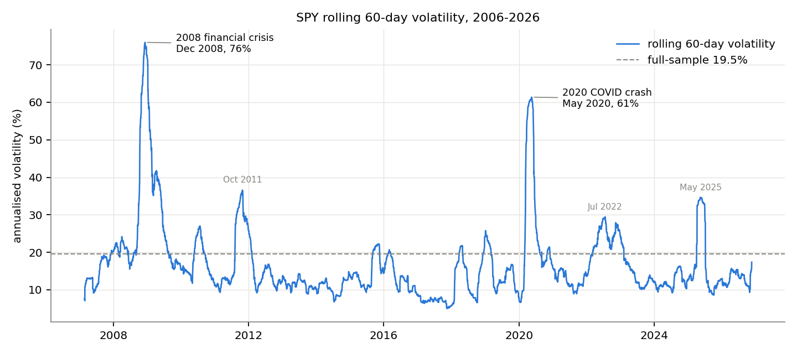
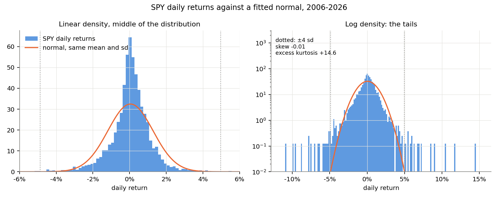
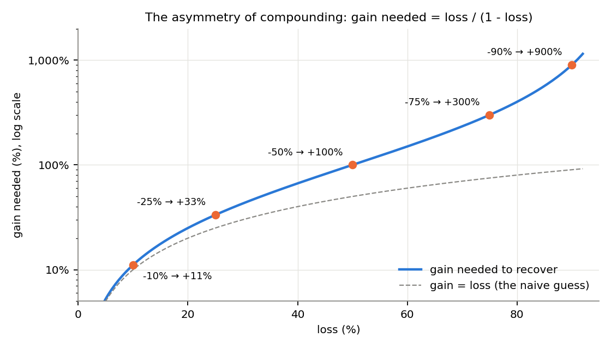
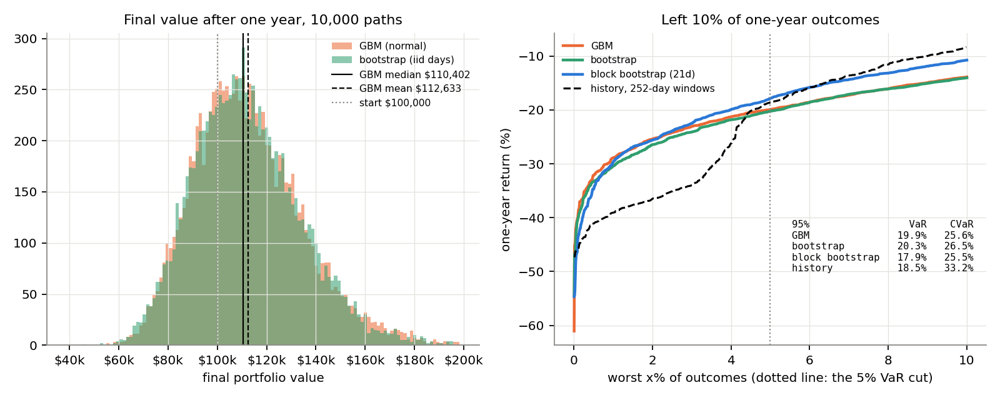

# Homework 9: Volatility, tails, and value at risk

All numbers come from hw09_starter.py, run on Monday 2026-11-23, so the last close in the data is Friday 2026-11-20. The full printed output is in hw09_output.txt, and the plots are saved separately as q3_rolling_vol.png, q4_return_histogram.png, q6_recovery.png and q7_q9_monte_carlo.png. They are also included in this document. The price history is saved in the data folder, so running the script with the --snapshot flag reproduces every number below. The script passes all 9 checks in check_hw09.py.

The data is 20 years of daily SPY closes from yfinance, from 2006-11-24 to 2026-11-20. That is 5,029 closes and 5,028 daily returns. Homework 8 priced an option on the traded price, so it used the raw close. This homework measures the risk of holding SPY, and a holder receives the dividends, so every return here comes from the dividend-adjusted close.

## Q1. Volatility, scaled from daily

The standard deviation of daily returns is 1.230%. Multiplying by the square root of 252 gives an annualised volatility of 19.52%. Both are inside the ranges in the check (0.7% to 1.3% daily, 12% to 20% a year), though near the top of each, because the sample includes 2008 and 2020.

## Q2. Volatility measured directly from calendar years

There are 19 full calendar years in the sample, 2007 to 2025. I left out 2006 and 2026 because they are partial years. The yearly total returns run from −36.80% in 2008 to +32.31% in 2013. Their standard deviation is 17.73%, against 19.52% from scaling daily volatility. The ratio of direct to scaled is 0.908, so the square-root rule overstates annual volatility by about 10%. With log returns the two figures are 18.25% and 19.54%, a ratio of 0.934.

The direction matches Homework 3. The square-root rule holds only if days are independent. Homework 3 found that a down day is slightly less likely after a down day than on an ordinary day. In this sample P(down) is 0.4485 and P(down | down yesterday) is 0.4374. The lag-1 autocorrelation of daily returns is −0.10. When days partly reverse each other, the variance of a year's return is less than 252 times the daily variance, so scaling up from daily volatility overstates annual volatility. That is the gap we see here.

I would not lean on the size of the gap. With only 19 yearly observations, the 95% confidence interval for the direct figure is 13.4% to 26.2%, which comfortably contains 19.52%. The figures at other horizons do not fall smoothly either. Annualised, weekly returns give 18.26%, monthly 15.52%, quarterly 16.74% and yearly 18.25%. Most of the negative autocorrelation also comes from the crises. Without 2008 and 2020 it falls to −0.05. So the direction is consistent with Homework 3, but the evidence for it is thin. The dependence that clearly is in the data is a different kind: the lag-1 autocorrelation of squared returns is +0.25. Big moves follow big moves, whichever direction they go. That does not change annual volatility much, but it matters a great deal for the tails in Q9.

## Q3. Rolling 60-day volatility

Each point on the plot is the standard deviation of the previous 60 daily returns, annualised and dated at the last day of the window. The highest value is 4.786% a day, or 76.0% annualised, on 2008-12-08. The lowest is 0.314% a day, or 5.0% annualised, on 2017-11-15, the calmest stretch in the sample.

The two largest spikes are the 2008 financial crisis (76.0%, in the window ending 2008-12-08, which covers the weeks after Lehman's collapse) and the 2020 COVID crash (61.4%, in the window ending 2020-05-18, which contains the March 2020 crash and its −10.9% day). The next largest, with each peak at least a year from the others, are the 2011 US downgrade and euro crisis (36.6%), the April 2025 tariff shock (34.6%) and the 2022 rate shock (29.5%).

The plot shows clustering clearly. Volatility spends long stretches between 8% and 15%, then jumps and stays high for months, and the high periods die away gradually rather than all at once. A simple way to measure this: when 60-day volatility is in its top 10%, it is still in its top 10% sixty trading days later 38% of the time. If volatility had no memory, the figure would be 10%.

This measure is wrong in a specific way too. A 60-day window gives the oldest day the same weight as yesterday and then drops it completely. So the measure is slow to react when a crisis starts, and it falls off a cliff exactly 60 days after the worst day, whatever the market is doing that day. The steep fall from late May to mid-June 2020 is the late-February and March crash days leaving the window, not the market calming down in those weeks.

## Q4. The shape of daily returns

The skewness of daily returns is −0.011 and the excess kurtosis is +14.59. There are 38 days with a move of more than four standard deviations, which is more than 4.92% in a day: 21 down and 17 up. The worst day was −10.94% on 2020-03-16, 8.9 standard deviations below the mean. The best was +14.52% on 2008-10-13, 11.8 standard deviations above.

The histogram shows both sides of the problem. Compared with a normal curve of the same mean and standard deviation, the data has a much taller and narrower peak. Most days are calmer than a normal would suggest, and a few days are far wilder. On the log scale the normal curve has dropped below the data well before ±5%, while the actual returns run out past −10% and +14%. Daily skew is close to zero because the rebounds inside crises, such as October 2008 and March 2020, are as violent as the falls. The asymmetry shows up over longer horizons, as in Homework 8. The tail days are also bunched together: 29 of the 38 four-sigma days fall in 2008 or 2020.

## Q5. Four-sigma days, expected and actual

Under a normal distribution, the chance of a move beyond four standard deviations in either direction is 6.33 × 10⁻⁵, or one day in about 15,800, roughly once every 63 years. Over 5,028 days a normal distribution predicts 0.32 such days. SPY had 38, which is **119 times** as many as a normal predicts. The gap grows further into the tail. Beyond 5 standard deviations a normal predicts 0.003 days and SPY had 19, about 6,600 times as many. Beyond 6 standard deviations it predicts 0.00001 and SPY had 12. Even at 3 standard deviations, the ratio is 6 times (84 days against 13.6).

The number to remember is that 20 years of SPY had about 120 times as many four-sigma days as a normal distribution allows. The standard deviation itself is inflated by the crises, which pulls the four-sigma line out to 4.9% and makes the count lower than it would otherwise be. Many of these days were not even four-sigma relative to the volatility at the time. That is the clustering from Q3 again: one standard deviation for 20 years describes neither the calm years nor the crises.

## Q6. The asymmetry of compounding

After a loss L, you have 1 − L of what you started with, and getting back to even needs a gain of L / (1 − L).

| Loss | Gain needed to recover |
|-----:|-----------------------:|
| 10% | +11.1% |
| 25% | +33.3% |
| 50% | +100.0% |
| 75% | +300.0% |
| 90% | +900.0% |

For small losses the gain needed is close to the loss. For large ones it explodes, and as the loss approaches 100% the gain needed goes to infinity. SPY's own worst case in this sample was a 55.2% total-return drawdown from 2007-10-09 to 2009-03-09. Recovering needed +123%, and SPY did not get back to its old high until 2012-08-16, almost five years after the peak. Two strategies with the same average return can end in very different places if one of them takes a deep drawdown along the way, because the loss is taken from a large base and the recovery has to be earned on a small one. That is why maximum drawdown matters more than average return.

## Q7. Monte Carlo with geometric Brownian motion

I estimated the parameters from daily log returns. Their mean times 252 is the median growth rate, 9.81% a year, and their standard deviation times the square root of 252 gives a volatility of 19.54%. The GBM drift is the arithmetic drift μ = 9.81% + σ²/2 = 11.72%. With these inputs, the expected final value matches what SPY actually returned on average. Each path takes 252 daily steps, and each step's log return is normal with mean (μ − σ²/2)/252 and standard deviation σ/√252. I ran 10,000 paths from $100,000 with seed 42.

| | Final value |
|---|---:|
| Mean | $112,633 |
| Median | $110,402 |
| 5th percentile | $80,084 |
| 95th percentile | $152,738 |

The theory gives a mean of $100,000 × e^μ = $112,436 and a median of $100,000 × e^(μ − σ²/2) = $110,310, and the simulation lands within a few hundred dollars of both. 30.5% of paths end below $100,000, and 54.1% end below the mean.

The mean and median differ because compounding turns symmetric shocks into an asymmetric outcome. The log of the final value is normal, so the final value itself is lognormal. A good year multiplies wealth and a bad year divides it, so the right tail stretches further than the left: the 95th percentile is $42,000 above the median, but the 5th percentile is only $30,000 below it. Those few very good paths pull the mean up. The gap between the two growth rates is exactly σ²/2, about 1.9% a year. This is volatility drag.

An investor should care about the median. You live through one path, not the average of 10,000, and the median is the outcome you are as likely to beat as to miss. The mean answers a different question: what a large group of investors in separate, independent copies of the market would earn in total. That is the right number for pricing, but not for planning your own wealth. The gap also compounds over time. Over 30 years these parameters give a mean of 33.6 times the starting value but a median of only 19.0 times. As the horizon grows, more and more of the mean comes from a smaller and smaller share of very lucky paths. Volatility drag also means that, at the same average return, lower volatility raises the median, which is part of why Session 10's position sizing matters.

## Q8. Value at risk and conditional value at risk

I measure each loss from the starting $100,000. VaR is the loss at the 5th percentile of one-year returns. CVaR is the average loss over all paths at or beyond that point.

| 95%, one year, GBM | Dollars | % of $100,000 |
|---|---:|---:|
| VaR | $19,916 | 19.92% |
| CVaR | $25,554 | 25.55% |

So in one year in twenty, the portfolio loses at least $19,916. In those bad years the average loss is $25,554. Measured from the expected value of $112,633 instead of from the start, the VaR would be $32,549. The two conventions differ by the drift, so a VaR figure always needs its reference point stated.

## Q9. Bootstrapping from actual daily returns

The bootstrap builds each one-year path from 252 days drawn at random, with replacement, from the 5,028 actual daily returns. The draws use the same seed and the same 10,000 paths, so the only thing that changes from Q7 is the shape of the daily distribution. I added two reference columns that the assignment does not ask for. The first is a block bootstrap, which draws 21-day runs of consecutive days instead of single days, so that some of the volatility clustering survives. The second is the 4,777 actual overlapping one-year windows in the data.

| 95%, one year | GBM (normal) | Bootstrap (iid days) | Block bootstrap, 21 days (extra) | History, 252-day windows (extra) |
|---|---:|---:|---:|---:|
| Mean final value | $112,633 | $112,205 | $112,570 | $112,189 |
| Median final value | $110,402 | $110,272 | $112,543 | $114,986 |
| VaR ($) | $19,916 | $20,260 | $17,852 | $18,522 |
| VaR (%) | 19.92% | 20.26% | 17.85% | 18.52% |
| CVaR ($) | $25,554 | $26,466 | $25,482 | $33,243 |
| CVaR (%) | 25.55% | 26.47% | 25.48% | 33.24% |

## Q10. Written

The bootstrap VaR is larger, $20,260 against $19,916, but only barely, and less than I expected given Q5. One run of 10,000 paths is too noisy to separate them on its own, so I repeated both methods with 20 different seeds. The VaR moves by about 0.28 points from seed to seed. Averaged over the 20 seeds, the bootstrap VaR is 0.12 points higher than GBM (standard error 0.10), and the bootstrap CVaR is 0.25 points higher (standard error 0.09). So the bootstrap is reliably a little worse in the far tail and hardly different at the VaR line.

The reason is that both methods use the same mean and variance, so they can differ only in shape, and summing 252 independent days removes most of the shape. Excess kurtosis of a sum of n independent draws is the daily excess kurtosis divided by n. That turns 14.6 into 0.058, and the simulated one-year log returns have an excess kurtosis of +0.06, which matches. The 119-to-1 excess of four-sigma days is real, but when the crash days are scattered at random across 10,000 different years, they average out with ordinary days. What the iid bootstrap throws away is the fact that the crash days arrived together. In the actual one-year windows, CVaR is 33.2%, eight points worse than either simulation, and the worst 5% of windows almost all start in 2007 or 2008. The block bootstrap keeps some of that clustering. It gives a more lopsided one-year distribution (skew −0.51 against roughly zero) and a larger gap between CVaR and VaR, though its lower overall volatility pulls its VaR down. 21-day blocks are still much shorter than a crisis that lasted a year and a half. So both of my VaR figures understate the true one-year tail. They model days well and years badly, and the error is in the same direction for both.

VaR at 95% tells you how often you will lose at least a certain amount, once in twenty years. It does not tell you how much you lose when that happens. Two portfolios can have the same 95% VaR of $20,000 while one loses $21,000 in its bad years and the other loses $60,000. VaR is a single quantile and cannot see anything beyond it. CVaR (also called expected shortfall) exists to answer that question: it is the average loss in the bad years, so it changes when the tail gets worse even if the VaR line does not move. It is also coherent where VaR is not. VaR can say that combining two positions is riskier than holding them separately, which punishes diversification. CVaR never does.

That blind spot is what makes VaR easy to game. Any trade that adds a small chance of a very large loss can be made to fit beyond the 95% (or 99%) line. Examples are selling deep out-of-the-money puts, as in Homework 8, or holding "super-senior" credit tranches before 2008. Such a trade earns steady income, shows little or no VaR, and still hides a catastrophe. Banks reported small trading VaRs right up to the 2008 losses. In 2012 JPMorgan's Chief Investment Office switched to a new VaR model that roughly halved the risk it reported on the position that became the London Whale loss. Regulators drew the same conclusion: the Basel Committee's market-risk rules (FRTB) replace 99% VaR with 97.5% expected shortfall. A risk number that ignores how bad the bad case gets invites positions built to look safe by that number.
